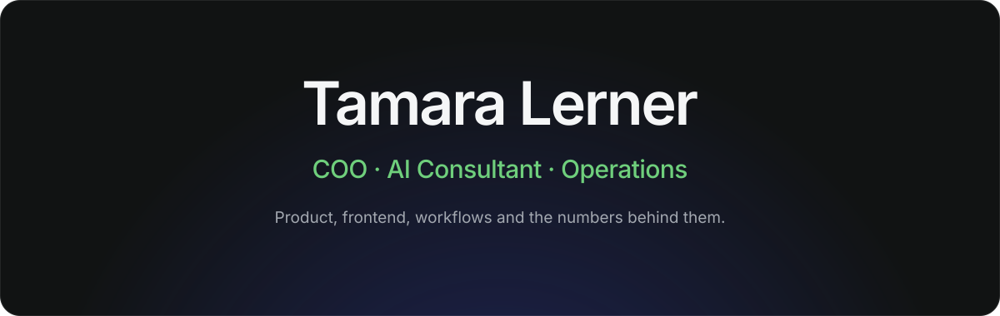
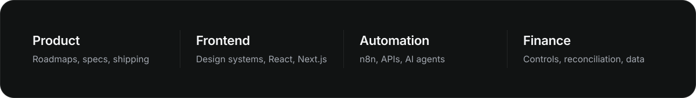
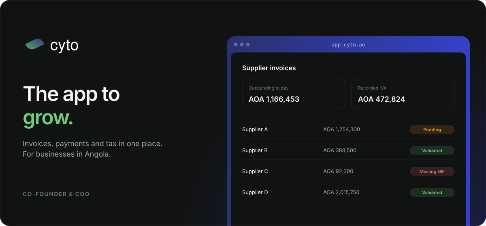
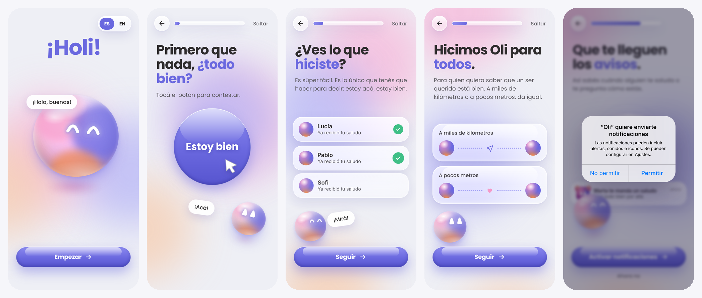

  

I work where operations, product and money meet. I run roadmaps with engineers, design and ship frontend, automate the manual work, and explain what it all means for cash, controls and the P&L.

Almost a decade across Google, capital markets, DeFi and AI startups. Master's in finance.

 

  

## Now

 

**CYTO** reads each invoice, checks it against AGT rules and matches it to the bank account. A finance back office for businesses in Angola, not another ERP.

- AGT-certified e-invoicing (FE/414/AGT/2026)
- Used by 50+ companies in Angola
- Monthly close from 7 days to 1

As co-founder and COO I own the operating model, product coordination and the design system.

 

<!-- NOTION: replace NOTION_PUBLIC_URL with the published notion.site link, then uncomment
  

## Pick my brain

-->

  

## Before

| | |
|---|---|
| **Rootstock Collective** | Director of Operations |
| **Veris Labs** acq. by Keyrock | Director of Operations |
| **UNION SGR** | Financial research & analysis |
| **Google** | Financial Analyst, SQL Accounting |

  

## On the side

Small products for people I care about

 

**Oli**: one tap to tell your people you're okay. Clickable prototype.

**DUBA**: a companion robot for older adults. Design stage. 
**[Ojo al Piojo](https://github.com/tamlerner/ojoalpiojo)**: a free anti-scam course for older adults in Argentina. 
**Mesa**: coworking at a neighbour's table. Prototype. 
**[Lastbook](https://github.com/tamlerner/lastbook)**: contributing an Argentina region proposal.

  

## Contact

  

Sapere aude

