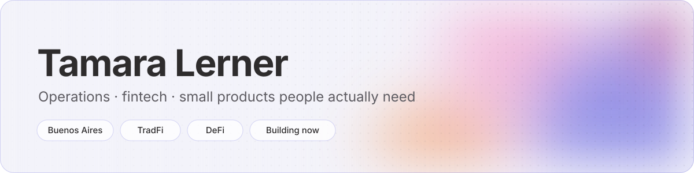
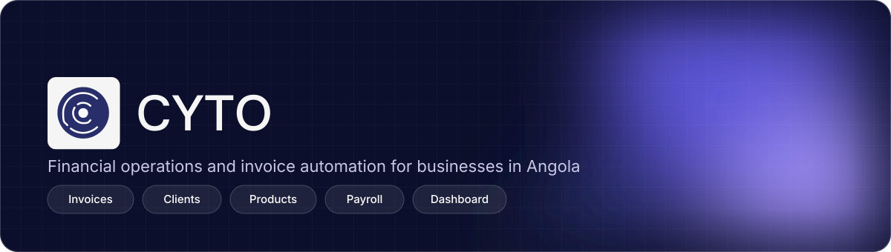
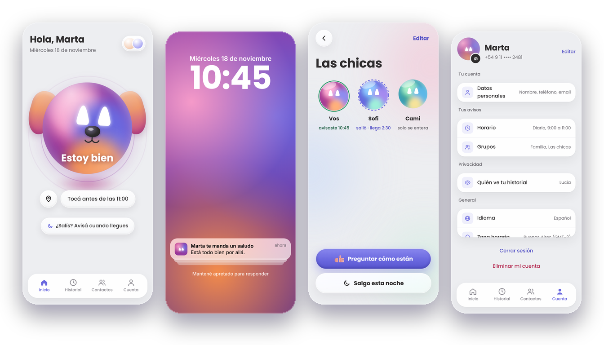

<picture>
  <source media="(prefers-color-scheme: dark)" srcset="assets/banner-dark.svg">
  
</picture>

 

Hi, I'm **Tam**. I'm Argentine, I've spent 10+ years in big tech, startups and fintech (Google, Dell, TradFi and DeFi), and I like turning messy processes into systems that work. I co-founded **CYTO**, and on the side I build small products for the people I care about.

<table>
  <tr>
    <td><b>Now</b></td>
    <td>Growing <a href="https://appcyto.com"><b>CYTO</b></a> · designing <b>Oli</b>, a one-tap "I'm okay" app</td>
  </tr>
  <tr>
    <td><b>Focus</b></td>
    <td>Operations · automation · fintech · tech for older adults</td>
  </tr>
  <tr>
    <td><b>Languages</b></td>
    <td>Spanish · English · Italian</td>
  </tr>
  <tr>
    <td><b>Find me</b></td>
    <td><a href="https://www.linkedin.com/in/tamlerner/">LinkedIn</a></td>
  </tr>
</table>

## Featured: CYTO

I'm a co-founder of [CYTO](https://appcyto.com), a platform that takes the paperwork out of running a business in Angola: invoicing, clients, products, payroll and a dashboard, in one place.

- **Invoices as PDFs:** generated to international standards, ready to send
- **One workspace:** clients, products and payroll next to the invoices they feed
- **A dashboard with charts:** see the business at a glance
- **Made for its users:** multi-language interface, light and dark theme, sign in with email or Google
- **Under the hood:** Next.js 14, TypeScript, Supabase (Postgres with row-level security), Tailwind

[Visit appcyto.com](https://appcyto.com) · [Public repo](https://github.com/tamlerner/cyto-app)

## Also building: Oli

> *Holi, soy Oli.* A little puppy that tells your people you're okay with one tap.

Oli is for anyone who wants the people they love to stop worrying: family, friends, long-distance partners, travellers, someone getting home late at night.

  

- **Tap once.** Daily on a schedule, or one-off when you head out.
- **Your people find out.** Chosen contacts get a notification right away.
- **They can ask too.** A contact asks "are you okay?" and you answer with one tap, without opening the app.
- **A safety net, not surveillance.** If you don't check in, Oli reminds you first, then alerts your contacts.

  

Status: clickable prototype (about 27 screens, liquid-glass UI, playable onboarding). No backend yet.

## Other things I'm working on

| Project | What it is | Stage |
|---|---|---|
| **DUBA** | A companion robot for older adults, dog-shaped and small-schnauzer-sized. Software first, hardware next | Design stage |
| **Ojo al Piojo** | A free, 15-minute tap-through course that teaches older adults in Argentina to spot scams | Working prototype |
| **Orbit** | See your people more, with less planning | Prototype |
| **Mesa** | Coworking at a neighbour's table: hosts open their home desk for a day | Clickable prototype |
| [**Lastbook**](https://github.com/tamlerner/lastbook) | Contributing an Argentina region proposal | Open source |

## What I've built

- Custom API integrations for cross-border financial transactions
- React dashboards for treasury management and visualization
- Automated compliance reporting with data validation
- Invoice generation to international standards
- Operations workflows and automations in n8n

## Stack

  &nbsp;
  &nbsp;
  &nbsp;
  &nbsp;
  &nbsp;
  &nbsp;
  

## Let's talk

Working on anything close to these? Applied AI, automation, fintech, aging or loneliness. I'd love to swap notes.

  

<i>"Sapere Aude": dare to know. Dare to build.</i>

